# Assembly guide – Ventbox module for the 1.9 L container

Rev 1.2 – 08 Nov 2026 (English release of rev 1.1, 26 Oct 2026) – Group 2. Applies to drawings VB-00 … VB-09 and BOM rev 1.2. The numbers in circles are the item numbers on the general assembly drawing VB-00.

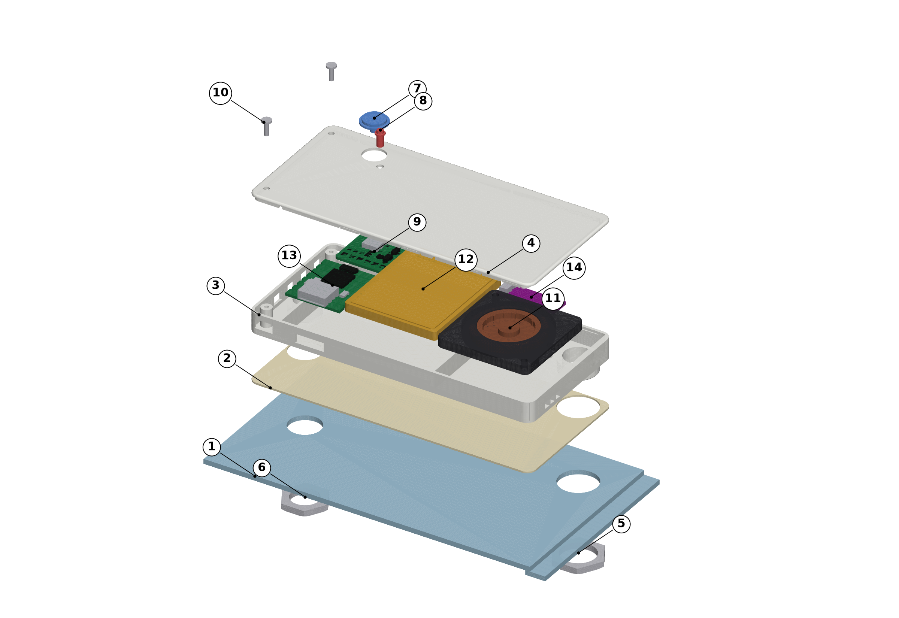

| Item | Part | Source |
|---|---|---|
| 1 | Original HPL818 container lid with 2 holes | VB-08 |
| 2 | Flat silicone gasket 0.5 | VB-03 (cut from DXF) |
| 3 | PETG module base | VB-01, `Module_base_PETG.stl` |
| 4 | PETG module cover | VB-02, `Module_cover_PETG.stl` |
| 5 | Nut M12×1, 2 mm thick | VB-04, `Nut_M12x1_2mm.stl` |
| 6 | Nut M10×1, 2 mm thick | VB-05, `Nut_M10x1_2mm.stl` |
| 7 | TPU / silicone button | VB-06, `Button_silicone.stl` |
| 8 | LED light pipe | VB-07, `LED_light_pipe.stl` |
| 9 | Sub-board 16×16 (AO3400A, SW1) | VB-09, KiCad gerbers |
| 10 | Self-tapping screw M1.6×5 wafer head ×2 | purchased |
| 11 | Sunon UB5U3-700 fan | purchased |
| 12 | LiPo battery LP303035 310 mAh | purchased |
| 13 | Seeed XIAO nRF52840 | purchased |
| 14 | SHT40 sensor breakout 7Semi ES-13521 | purchased |
| 15 | Double-sided tape ≤ 0.15 mm (3M 9448A) | purchased |

Assembling one unit takes about 60–90 minutes, not counting 3D-printing time and the curing time of the silicone sealant.

## Tools and materials

**Tools:**
- soldering iron with 0.5–1 mm tip, set to about 320–340 °C, 0.3–0.5 mm solder, flux;
- tweezers, wire stripper for 30 AWG;
- PH000 screwdriver (or a bit that fits M1.6 screws);
- multimeter;
- hand drill, Ø3 drill bit and step drill (up to Ø13), small round file;
- utility knife, calipers;
- USB-C cable with data lines.

**Materials:**
- 30 AWG silicone wire, red and black (plus 4 other colours if available);
- Kapton tape;
- food-safe RTV silicone sealant;
- moisture-protection conformal coating;
- IPA (isopropyl alcohol);
- USB-C dust plug.

## Preparing the parts

1. **3D-print** the 6 parts in `mechanical/stl/`, using the print orientation and settings given in `mechanical/README.md`.
   - Base: printed upside down, with tree supports.
   - Module cover: top face down on the bed, no supports needed.
   - Nuts: printed flat, 0.1 layers.
2. **Clean the prints:** remove the supports and scrape off burrs at the following places:
   - snap grooves in the 3 base walls;
   - snap rim of the module cover;
   - USB-C opening;
   - air slots.
3. **Test the threads:** screw nuts (5) and (6) onto the threaded spigots of the base.
   - They must screw on by hand all the way down the thread.
   - If tight, chase the thread with an M12×1 / M10×1 die, or reprint with a larger thread clearance.
4. **Cut the gasket (2)** from 0.5 mm silicone sheet, using `mechanical/drawings/dxf/VB-03_Flat_gasket.dxf` (scale 1:1).
5. **Solder the sub-board (9):** solder Q1, R1, R2, D1, SW1 according to `electronics/kicad/fab/ventbox_pos.csv` and the schematic.
   - Clean off the flux with IPA.
   - Check there is no short between B+ and G.
6. **Flash the XIAO firmware before assembly:** follow `firmware/README.md` and flash via USB-C while the XIAO is still loose.

## Step 1 – Drill the lid holes

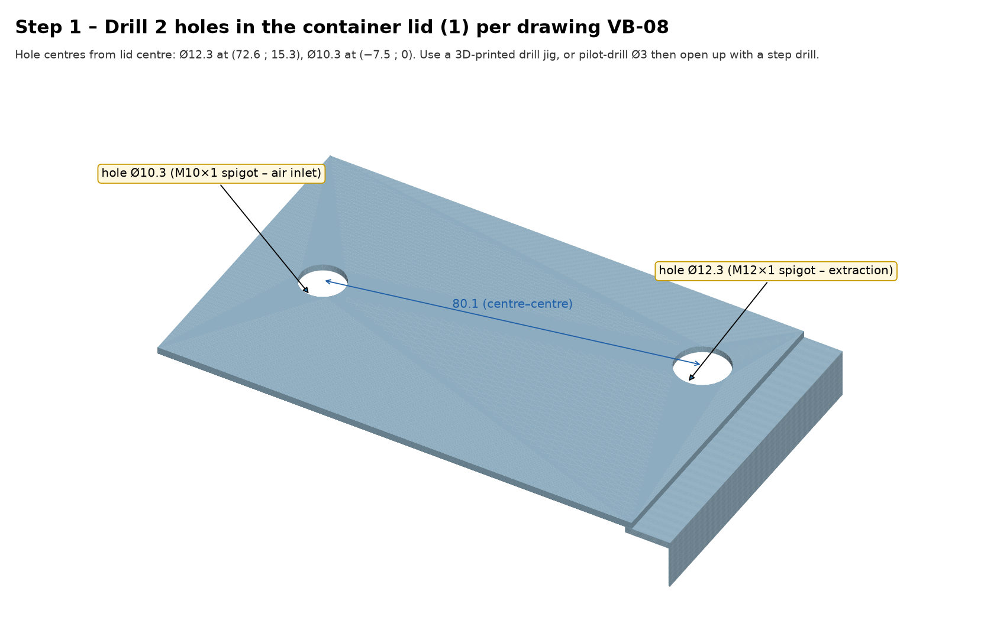

1. Remove the original lid seal so it does not get burnt or torn.
2. Mark the 2 hole centres per VB-08 (coordinates from the lid centre):
   - Ø12.3 hole at (72.6, 15.3);
   - Ø10.3 hole at (−7.5, 0);
   - the distance between the 2 hole centres is 80.1 mm.
   - The easiest way is to place the module base (3) itself on the lid: the 2 threaded spigots mark the exact hole centres.
3. Pre-drill Ø3, then open up with the step drill at low speed so the plastic does not melt.
4. File off the burrs on both sides. Test-fit the threaded spigots of the base: they must pass through the holes with about 0.15 mm clearance per side.

## Step 2 – Solder the wires per the wiring diagram

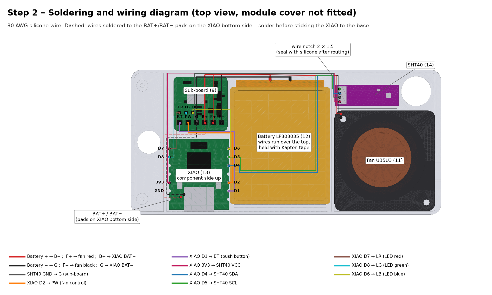

| Wire | From | To | Notes |
|---|---|---|---|
| red | battery + | sub-board B+ (TP4) | runs along the +Y edge of the battery |
| black | battery − | sub-board G (TP3) | |
| red | sub-board B+ | XIAO BAT+ (bottom-side pad) | solder before sticking the XIAO down |
| black | sub-board G | XIAO BAT− (bottom-side pad) | solder before sticking the XIAO down |
| orange | XIAO D2 | sub-board PW (TP2) | fan control |
| purple | XIAO D1 | sub-board BT (TP1) | push button |
| red | sub-board F+ (TP5) | fan red wire | through the wire slot |
| black | sub-board F− (TP6) | fan black wire | through the wire slot |
| pink | XIAO 3V3 | SHT40 VCC | through the wire slot |
| grey | sub-board G | SHT40 GND | through the wire slot |
| blue | XIAO D4 | SHT40 SDA | through the wire slot |
| green | XIAO D5 | SHT40 SCL | through the wire slot |
| brown | XIAO D7 | sub-board LR (TP7) | red LED, 1.0 mm pad |
| turquoise | XIAO D8 | sub-board LG (TP8) | green LED |
| yellow | XIAO D6 | sub-board LB (TP9) | blue LED |

Soldering notes:
- **Solder the battery last.** The battery is the last part to be soldered, and the battery leads must be insulated immediately to avoid shorts.
- **Measure before cutting the wires.** Place the parts in the base and measure the actual wire lengths before cutting. Allow about 5 mm extra per wire; excess wire makes the module cover bulge.
- **Wire routing.** Wires lie flat on the floor or on top of the battery. Wires must not lie where the snap rim of the module cover goes (the area next to the walls, from z 123.7 upwards).
- **Check before powering up.** Check the continuity of every wire against the table. The resistance between B+ and G must be greater than 1 kΩ.

## Step 3 – Install the fan

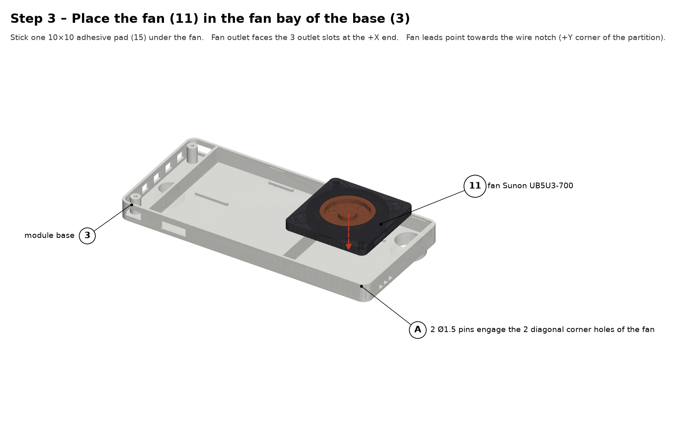

1. Wipe the floor of the base with IPA.
2. Stick a piece of tape (15) of about 10×10 under the fan (11), avoiding the air inlet.
3. Lower the fan so that the 2 Ø1.5 pins enter the 2 diagonal corner holes of the fan.
   - The fan outlet faces the 3 outlet slots at the +X end.
4. Route the fan wires through the 2 × 1.5 slot in the +Y corner of the fan-chamber wall.

## Step 4 – Fix the battery and SHT40

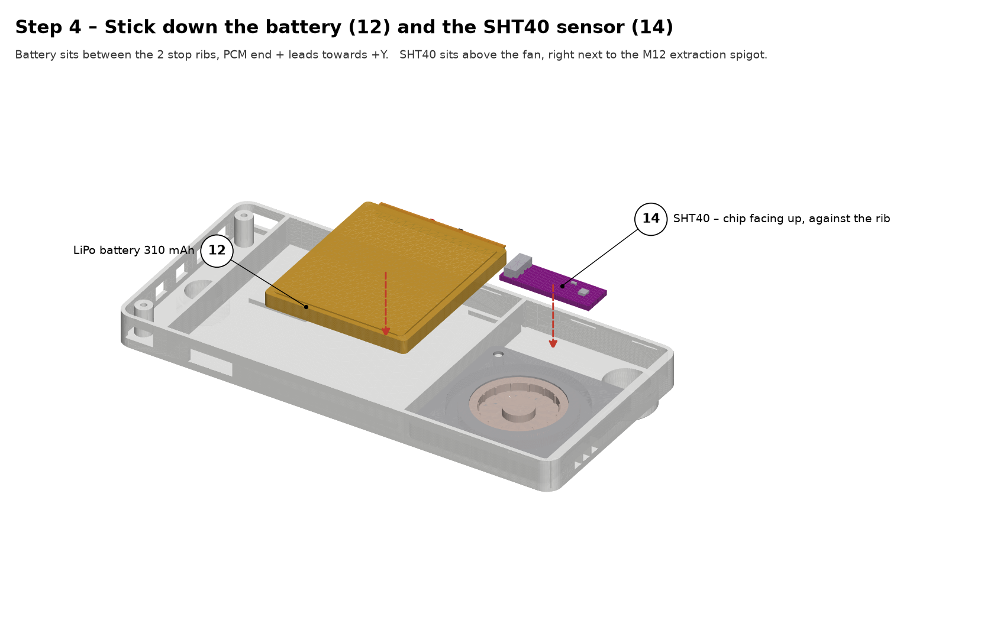

1. **Battery (12):**
   - Apply 2 strips of tape under the battery.
   - Place the battery between the 2 stop ribs, with the protection-circuit (PCM) end facing +Y.
   - Wrap the PCM in Kapton if the supplier has not already done so.
2. **SHT40 (14):**
   - Place it chip side up, resting against the rib, above the fan and next to the M12 humidity-extraction spigot.
   - Do not apply adhesive or conformal coating over the sensor opening.
3. Route the 4 SHT40 wires through the wire slot together with the fan wires.

## Step 5 – Fix the XIAO and sub-board, electrical check

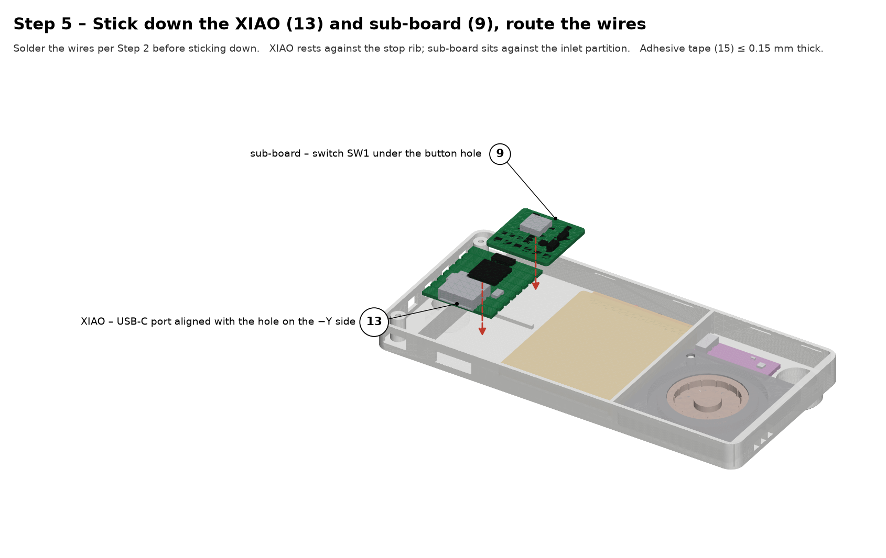

1. **XIAO (13):** apply tape under the XIAO, leaving the soldered BAT pad area free.
   - Press it in so the USB-C port fits into the opening in the −Y side.
   - The XIAO edge rests against the stop rib.
2. **Sub-board (9):** stick it down so that button SW1 is centred under the button hole of the module cover, at (6.5, 14.0).
3. **Tidy the wires:** tape the wires to the top of the battery with Kapton.
4. **Seal the wire slot** with a little RTV silicone to keep the fan chamber airtight.
5. **Electrical check before closing the cover:**
   - **Battery:** voltage between B+ and G about 3.7–4.2 V.
   - **RGB LED D2:** at power-up the LED flashes red, green, blue once. If a colour is missing, check wires D7/D8/D6 and the LED solder joints.
   - **Button:** short-press SW1, the fan must run and the LED flashes blue. Press again and the fan stops.
   - **Timer:** hold SW1 for 2 s until it flashes green, then release; the LED must flash green 3 times.
   - **Charging:** plug in USB-C, the charge LED on the XIAO must light up.
   - **Sensor:** breathe moist air (your breath) into the M12 spigot. Within 60 s the fan must start by itself and run for 30 s.
6. **Conformal coating:** brush a coat of conformal coating onto the XIAO and the sub-board. Mask the USB-C port, button SW1 and the SHT40 before coating. Let it dry per the manufacturer's instructions.

## Step 6 – Fit the button and light pipe into the module cover

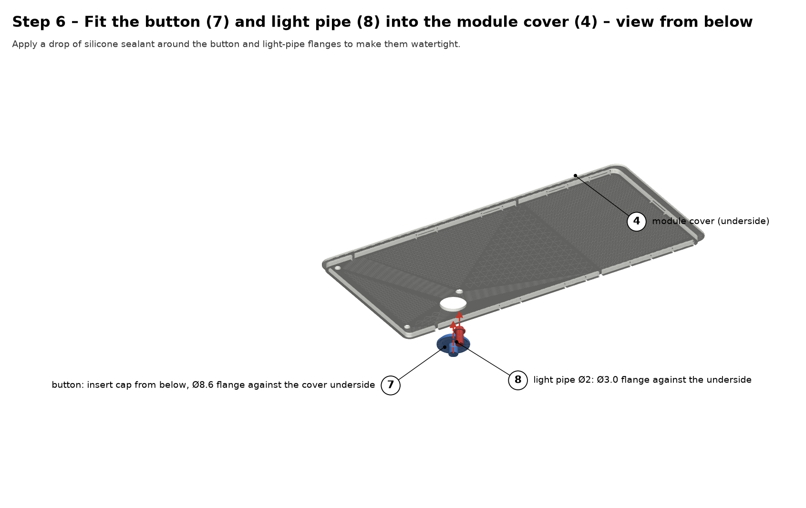

1. Turn the module cover (4) upside down.
2. **Button (7):** insert the button cap from below through the Ø7.2 hole, so the Ø8.6 flange seats against the underside of the cover.
3. **Light pipe (8):** insert it the same way through the Ø2.1 hole, so the Ø3.0 flange seats against the underside. The light pipe is centred over RGB LED D2 on the sub-board.
4. Apply a thin bead of RTV silicone around the 2 flanges to keep condensation out in the refrigerator. Let it cure.
   - Wipe off excess silicone; keep it away from the snap rim.

## Step 7 – Close the module cover

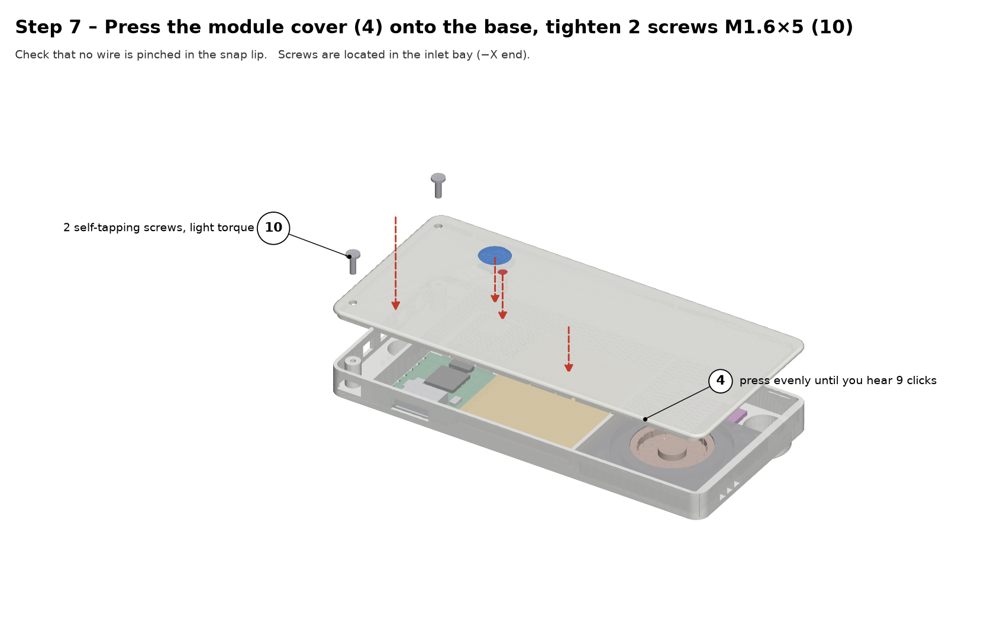

1. Check that no wire lies under the snap rim and that both partitions have clear slots.
2. Place the module cover (4) on the base, −X end first, so that the 2 screw holes line up with the 2 screw bosses.
3. Press evenly around the perimeter until all 9 latches click: 4 latches on each long wall and 1 latch at the +X end.
4. **Tighten the screws (10):** drive the 2 M1.6×5 self-tapping screws into the bosses (Ø1.3 pilot holes).
   - Tighten by hand and stop when the screw head just touches the cover surface. Over-tightening strips the plastic thread.
5. Test the button: it must click and spring back when released.

The screw heads protrude 0.6 mm above the module cover surface.

## Step 8 – Mount the module on the container lid

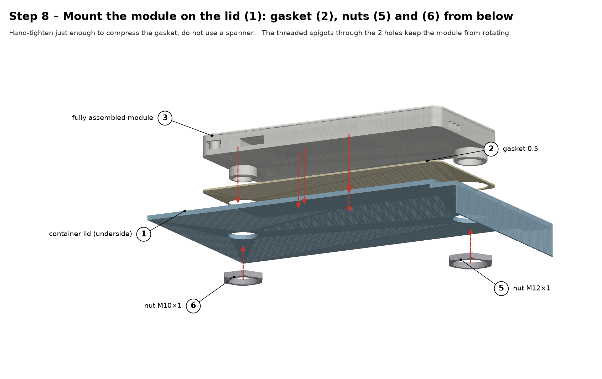

1. Wipe the lid surface around the 2 holes with IPA.
2. Slide the gasket (2) over the 2 threaded spigots under the base.
3. Place the module on the container lid (1), with the 2 threaded spigots through the 2 drilled holes.
4. Turn the lid over and screw on nut M12×1 (5) and nut M10×1 (6) from the underside.
   - Tighten by hand until the gasket is compressed evenly. Do not use a spanner.
5. Refit the original lid seal.

## Step 9 – Finishing and final check

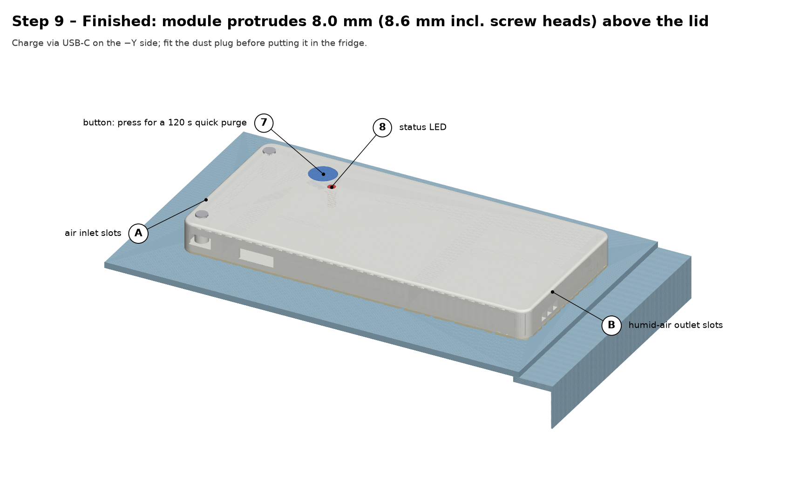

Checklist:

| Item | How to check | Pass when |
|---|---|---|
| Height | calipers from the lid surface | 8.0 mm (8.6 mm at the screw heads), stackable |
| Seal around the gasket | close the lid on the container, gently squeeze the container body, listen and feel around the module | no air leaks around the gasket, air only passes through the air slots |
| Air path | press the button, hold a piece of tissue at the outlet slots at the +X end | the tissue is blown away |
| Button and LED | press the button; hold for 2 s | it clicks and the LED flashes blue; holding 2 s gives 3 green flashes, clearly visible through the light pipe |
| Charging | plug in USB-C | charges; afterwards fit the dust plug |
| Cleaning the lid | | only wipe the top surface with a damp cloth. Do not immerse in water, not dishwasher-safe |

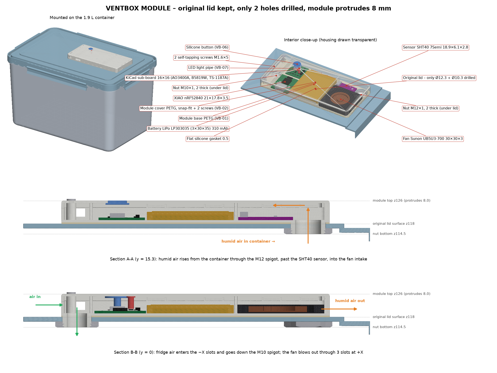

## Using the freshness timer

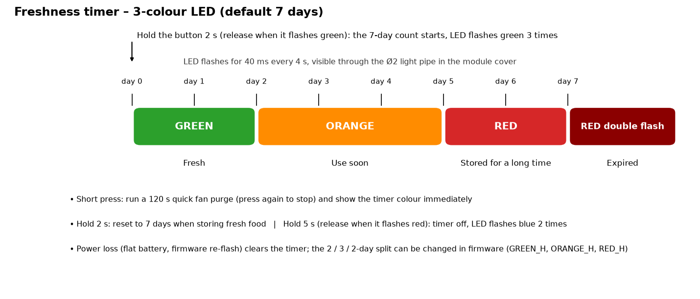

1. Put the food in the container and close the lid.
2. Hold the button for 2 s and release when the LED flashes green. 3 green flashes mean the 7-day count has started.
3. The LED gives a short flash every 4 s:
   - green for the first 2 days (fresh);
   - orange for the next 3 days (use soon);
   - red for the last 2 days (stored for a long time);
   - red double flash after 7 days (expired).
4. When all the food has been taken out: hold the button for 5 s and release when it flashes red to switch the timer off. When storing new food: hold for 2 s to reset.

The timer runs independently of the fan: the fan keeps extracting humidity based on the sensor whether the timer is on or off.

## Troubleshooting

| Symptom | Common cause | Remedy |
|---|---|---|
| Nut does not screw on | 3D-printed thread too thick | chase with a die, or print the nut in resin |
| Module cover does not latch fully | wire trapped under the rim, or burrs in the snap grooves | re-route the wires, clean the grooves |
| No click when pressing the button | tape under the sub-board too thick, or button off-centre | use tape ≤ 0.15 mm, re-stick the sub-board |
| Fan does not run | F+/F− wires swapped, Q1 faulty, battery below 3.35 V (LED flashes blue/red alternately 3 times) | re-check the wires, charge the battery |
| LED missing a colour | wire D7/D8/D6 broken, LED soldered the wrong way round | check the wires; the pin 1 mark (chamfered corner) of the LED must be at the top left per VB-09 |
| Timer lost by itself | battery flat or firmware just re-flashed | charge the battery, then hold the button 2 s to reset |
| Fan does not start by itself when humid | SDA/SCL wires swapped, SHT40 not detected | swap the D4/D5 wires, check I2C address 0x44 |
| Condensation under the module | gasket not compressed evenly | tighten both nuts evenly, check the gasket is not twisted |

## Safety notes

- **LiPo battery:** do not puncture or crush the battery and do not solder directly onto the cell. Do not charge while the module is in a refrigerator below 0 °C.
- **Food-contact materials:** use food-safe PETG, silicone and RTV sealant for every part in contact with the air inside the container.
- **To be checked on a real prototype before series assembly:**
  - actual XIAO height (the model assumes 3.5 mm);
  - position of the corner holes on the real fan;
  - position of the BAT+/BAT− pads on the underside of the XIAO, per the [Seeed Wiki](https://wiki.seeedstudio.com/XIAO_BLE/).
